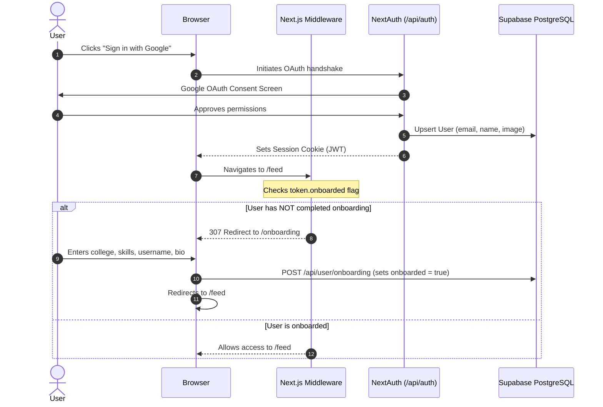
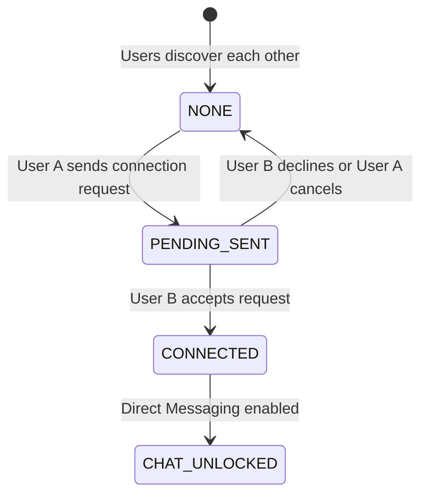
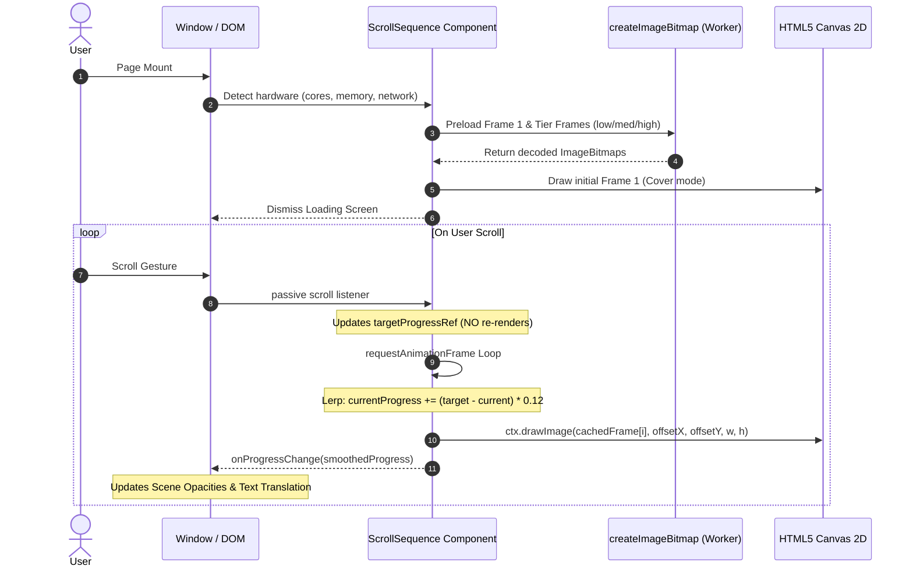

# ShowUp — Architecture & System Workflow Guide

> Comprehensive breakdown of how ShowUp works: from the high-performance scroll-driven canvas engine on the landing page to serverless connection pooling, real-time messaging, and social matching.

---

## Table of Contents
1. [System Overview & Architecture](#1-system-overview--architecture)
2. [Landing Page: Scroll-Driven Canvas Engine](#2-landing-page-scroll-driven-canvas-engine)
   - [The Problem with Video Seeking](#the-problem-with-video-seeking)
   - [The Multi-Tier Image Sequence Solution](#the-multi-tier-image-sequence-solution)
   - [Offline Frame Extraction Pipeline](#offline-frame-extraction-pipeline)
   - [Hardware-Adaptive Runtime Tier Selection](#hardware-adaptive-runtime-tier-selection)
   - [Progressive Off-Thread Preloading Pipeline](#progressive-off-thread-preloading-pipeline)
   - [Single rAF Lerp Physics Loop](#single-raf-lerp-physics-loop)
   - [Canvas Aspect Ratio Cover Math](#canvas-aspect-ratio-cover-math)
   - [Editorial Scene Transitions Synchronization](#editorial-scene-transitions-synchronization)
3. [User Journey & App Data Workflows](#3-user-journey--app-data-workflows)
   - [Authentication & Onboarding Flow](#authentication--onboarding-flow)
   - [Project Feed & Discovery Flow](#project-feed--discovery-flow)
   - [Teammate Matching Flow](#teammate-matching-flow)
   - [Connection Lifecycle](#connection-lifecycle)
   - [Direct Messaging & Chat Engine](#direct-messaging--chat-engine)
4. [Backend, Database & Serverless Optimization](#4-backend-database--serverless-optimization)
   - [Prisma & Supabase PgBouncer Pooler Setup](#prisma--supabase-pgbouncer-pooler-setup)
   - [Elimination of N+1 Queries](#elimination-of-n1-queries)
   - [SWR Client-Side Polling Deduplication](#swr-client-side-polling-deduplication)
   - [Immutable Asset Caching](#immutable-asset-caching)
5. [Complete System Flow Diagrams](#5-complete-system-flow-diagrams)
6. [File & Directory Map](#6-file--directory-map)

---

## 1. System Overview & Architecture

ShowUp is a full-stack platform built for Indian college builders, designers, and engineers to share proof-of-work, assemble hackathon teams, and message peers directly.

```
┌────────────────────────────────────────────────────────────────────────┐
│                          Client Layer (Next.js 14)                     │
│  ┌──────────────────────┐  ┌────────────────────┐  ┌─────────────────┐ │
│  │ Canvas Scroll Engine │  │ Feed & Social UI   │  │ Real-time Chat  │ │
│  │ (ScrollSequence.jsx) │  │ (Project cards/mod)│  │ (SWR Polling)   │ │
│  └──────────────────────┘  └────────────────────┘  └─────────────────┘ │
└────────────────────────────────────┬───────────────────────────────────┘
                                     │ HTTPS / Next.js App Router
┌────────────────────────────────────▼───────────────────────────────────┐
│                     Edge & Serverless API Routes                       │
│  ┌──────────────────────┐  ┌────────────────────┐  ┌─────────────────┐ │
│  │  auth/[...nextauth]  │  │   /api/project     │  │    /api/chat    │ │
│  │  (JWT + Google OAuth)│  │   /api/teammates   │  │  /connections   │ │
│  └──────────────────────┘  └────────────────────┘  └─────────────────┘ │
└────────────────────────────────────┬───────────────────────────────────┘
                                     │ PgBouncer Port 6543 (connection_limit=1)
┌────────────────────────────────────▼───────────────────────────────────┐
│                    Persistence & External Services                     │
│  ┌─────────────────────────┐   ┌─────────────────────────────────────┐ │
│  │   Supabase PostgreSQL   │   │         Cloudinary CDN              │ │
│  │   (Prisma ORM Models)   │   │      (Project & User Media)         │ │
│  └─────────────────────────┘   └─────────────────────────────────────┘ │
└────────────────────────────────────────────────────────────────────────┘
```

---

## 2. Landing Page: Scroll-Driven Canvas Engine

### The Problem with Video Seeking
Originally, the landing page scrubbed an HTML5 `<video>` element by setting `video.currentTime = progress * duration` during `window.onscroll`. While smooth on high-end discrete GPUs (e.g. RTX 5050), this created severe lag and stutter on mobile devices, low-power laptops (Intel Core i3), and budget Android phones due to:
1. **Long GOP (Group of Pictures) Keyframe Intervals**: The video had keyframes spaced every 5.8 seconds. Seeking to non-keyframes required the GPU/CPU to decode up to 175 delta frames backwards and forwards before rendering a single frame.
2. **Main-Thread Video Decoding Bottlenecks**: `currentTime` writes trigger asynchronous decoder queues that drop frames when scrubbed faster than the hardware decode rate.
3. **Scroll Listener Thrashing**: React state updates inside scroll events triggered rapid re-renders of the entire DOM tree.

### The Multi-Tier Image Sequence Solution
We replaced video seeking with a **canvas-based frame sequence engine** (`ScrollSequence.jsx`) inspired by Apple and Igloo hardware product showcases.

Key characteristics:
- Every frame is an independent, pre-compressed **WebP** image (no inter-frame dependency or delta calculation).
- WebP blobs are decoded off the main thread using `createImageBitmap()`.
- Frames are drawn directly to an HTML5 `<canvas>` using 2D context bitmap blits (`ctx.drawImage()`).

---

### Offline Frame Extraction Pipeline
Frames are pre-rendered into three resolution and frame-rate tiers using `scripts/extract-frames.js` and FFmpeg:

| Tier | Dimensions | Frame Rate | Total Frames | Total Size | Target Hardware |
| :--- | :--- | :--- | :--- | :--- | :--- |
| **Low** | 640 × 360 | 6 fps | 60 frames | **0.94 MB** | Mobile devices, low RAM (<4GB), Data Saver, 2G/3G |
| **Medium** | 960 × 540 | 9 fps | 90 frames | **2.31 MB** | Mid-range laptops (i3/i5), tablets, standard mobile |
| **High** | 1280 × 720 | 13 fps | 130 frames | **4.46 MB** | High-end desktop monitors (8+ cores, 8GB+ RAM) |
| **Poster** | 1280 × 720 | 1 static | 1 frame | **15 KB** | Initial instant load / SSR fallback placeholder |

Extraction command syntax used by the pipeline:
```bash
ffmpeg -y -i showup-demo.mp4 \
  -vf "fps=9,scale=960:-1:flags=lanczos" \
  -vcodec libwebp -quality 75 -compression_level 4 \
  "public/frames/medium/frame_%04d.webp"
```

---

### Hardware-Adaptive Runtime Tier Selection
File: `components/landing/adaptiveTier.js`

On initial client load, `getAdaptiveTier()` evaluates browser hardware flags and environmental constraints to choose the tier:

```
                          User visits Landing Page
                                     │
                      ┌──────────────┴──────────────┐
                      ▼                             ▼
              conn.saveData == true?        effectiveType in [2g, slow-2g]?
                      │ YES                         │ YES
                      └──────────────┬──────────────┘
                                     ▼
                             Force 'low' tier
                                     │ NO
                      ┌──────────────┴──────────────┐
                      ▼                             ▼
              navigator.deviceMemory < 4GB?    hardwareConcurrency <= 2?
                      │ YES                         │ YES
                      └──────────────┬──────────────┘
                                     ▼
                             Select 'low' tier
                                     │ NO
                      ┌──────────────┴──────────────┐
                      ▼                             ▼
               Is Mobile (<768px)?         Low-end Desktop (i3, <8GB RAM)?
                      │ YES                         │ YES
                      ▼                             ▼
             Select 'medium' tier          Select 'medium' tier
             (2x retina for 400px screen)           │ NO
                                                    ▼
                                           Select 'high' tier
                                      (8+ cores, 8GB+ RAM, fast desktop)
```

---

### Progressive Off-Thread Preloading Pipeline
File: `components/landing/ScrollSequence.jsx`

To prevent network congestion or UI stalls, images are loaded progressively:
1. **Critical Phase 1 (Frame 1)**: First frame is fetched immediately. As soon as decoded, the loading overlay is dismissed, making the site interactive in under 150ms.
2. **Critical Phase 2 (Frames 2–15)**: The first segment is loaded with highest priority so early scrolling is instantly responsive.
3. **Background Phase (Remaining frames)**: Batches of 5 concurrent requests download remaining frames without blocking main thread execution.
4. **Off-Thread Decoding**: Frames are decoded into GPU memory using `createImageBitmap(blob)`:
   ```javascript
   const res = await fetch(url, { cache: 'force-cache' })
   const blob = await res.blob()
   const bitmap = await createImageBitmap(blob) // Decodes off the UI thread
   framesRef.current[frameIndex] = bitmap
   ```
5. **Nearest-Loaded Fallback**: If the user scrolls rapidly past un-downloaded frames, the renderer searches backward and forward for the nearest cached frame. The screen **never flickers black or shows a blank frame**.

---

### Single rAF Lerp Physics Loop
Scrolling updates a ref without calling React's `setState`:

```javascript
const handleScroll = () => {
  const rect = driver.getBoundingClientRect()
  const scrollableDist = rect.height - window.innerHeight
  const rawProgress = Math.min(1, Math.max(0, -rect.top / scrollableDist))
  targetProgressRef.current = rawProgress // Zero re-renders
  startLoop()
}
window.addEventListener('scroll', handleScroll, { passive: true })
```

Inside the `requestAnimationFrame` loop, the current frame position smoothly catches up to the target scroll position using Linear Interpolation (Lerp):

$$\text{currentProgress} \mathrel{+}= (\text{targetProgress} - \text{currentProgress}) \times 0.12$$

- **Damping Factor (0.12)**: Provides smooth inertia across high-refresh displays and touch flick-scrolling.
- **Auto-Stop**: When $|\text{target} - \text{current}| < 0.0001$, the rAF loop halts automatically to consume 0% CPU at rest.
- **IntersectionObserver & Page Visibility**: Pauses the loop when scrolled out of view or when switching browser tabs.

---

### Canvas Aspect Ratio Cover Math
To replicate `object-fit: cover` on high-DPI screens without pixelation:
1. Canvas internal dimensions are scaled to the device pixel ratio (capped at `dpr = Math.min(window.devicePixelRatio || 1, 2)` to protect mobile VRAM).
2. The draw transformation calculates uniform scaling:

$$\text{scale} = \max\left(\frac{\text{canvasWidth}}{\text{imageWidth}}, \frac{\text{canvasHeight}}{\text{imageHeight}}\right)$$

$$\text{drawWidth} = \text{imageWidth} \times \text{scale}, \quad \text{drawHeight} = \text{imageHeight} \times \text{scale}$$

$$\text{offsetX} = \frac{\text{canvasWidth} - \text{drawWidth}}{2}, \quad \text{offsetY} = \frac{\text{canvasHeight} - \text{drawHeight}}{2}$$

3. `ctx.drawImage(frame, offsetX, offsetY, drawWidth, drawHeight)` renders centered, full-bleed backgrounds on any display ratio.

---

### Editorial Scene Transitions Synchronization
File: `components/landing/LandingClient.jsx`

As `currentProgress` interpolates from `0.0` to `1.0`, `onProgressChange` broadcasts smoothed progress values (throttled to `Δ > 0.003`) to update active editorial scenes:

| Scene | Progress Window | Alignment | Content |
| :--- | :--- | :--- | :--- |
| **00: Brand Logo** | `0.00 - 0.04` | Center | ShowUp Wordmark Hero Logo |
| **Intro Hero** | `0.05 - 0.15` | Center | *"Build. Share. Connect. The social platform for Indian college students"* |
| **01: Project Feed** | `0.17 - 0.32` | Left | *"Share what you build. Post projects. Get discovered."* |
| **02: Teammates** | `0.34 - 0.52` | Right | *"Find your hackathon squad. Filter by skill, college & interest."* |
| **03: Connections** | `0.54 - 0.72` | Left | *"No noise. Just builders. Real connections with people who ship."* |
| **04: About Us** | `0.74 - 0.88` | Center | Direct link to team mission and story (`/about`) |
| **05: Call-to-Action** | `0.90 - 1.00` | Center | Final Google OAuth CTA button (`Sign in with Google`) |

Opacity fade is calculated using an edge-fade window:
```javascript
function opacity(p, start, end) {
  const fade = 0.04
  if (p < start || p > end) return 0
  const fadeIn = start <= 0 ? 1 : Math.min(1, (p - start) / fade)
  const fadeOut = end >= 1 ? 1 : Math.min(1, (end - p) / fade)
  return Math.min(fadeIn, fadeOut)
}
```

---

## 3. User Journey & App Data Workflows

### Authentication & Onboarding Flow
ShowUp uses **NextAuth.js** configured with the Google OAuth 2.0 provider and Prisma adapter.



---

### Project Feed & Discovery Flow
1. **Creation**:
   - User navigates to `/project/new`.
   - Uploads a cover image directly to **Cloudinary** via unsigned upload preset.
   - Enters title, description, tech stack tags, and live/GitHub links.
   - Saves to database via `POST /api/project`.
2. **Exploration**:
   - Feed at `/feed` retrieves projects ordered by `createdAt: 'desc'`.
   - Includes author profile information, like count, comment count, and user's like status.
   - Supports optimistic liking (heart updates immediately before API responds).

---

### Teammate Matching Flow
1. Users toggle their profile status: `lookingForTeam: true` and specify `hackathonInterests`.
2. In `/teammates`:
   - Search by keyword, college name, branch, skills, or target hackathons.
   - Cards display mutual connection status: `NONE`, `PENDING_SENT`, `PENDING_RECEIVED`, or `CONNECTED`.

---

### Connection Lifecycle
Connections bridge users for networking and unlock direct messaging:



---

### Direct Messaging & Chat Engine
ShowUp provides a messaging system between connected users:

1. **Conversation Creation**:
   - When User A clicks "Message" on User B's profile, `POST /api/chat/conversations` is called.
   - Normalizes user IDs alphabetically (`userAId = min(A, B)`, `userBId = max(A, B)`) to satisfy the unique constraint `@@unique([userAId, userBId])`.
2. **Sending Messages**:
   - User types message and submits.
   - UI appends an **optimistic message bubble** immediately with a pending indicator.
   - Sends payload to `POST /api/chat/conversations/[id]/messages`.
   - Replaces optimistic message with confirmed server record.
3. **Message Polling & Synchronization**:
   - Uses **SWR (Stale-While-Revalidate)** with an adaptive refresh interval (3 seconds on active chat).
   - Deduplicated across component instances to prevent redundant network calls.
   - Pauses polling automatically when the browser tab loses focus.

---

## 4. Backend, Database & Serverless Optimization

### Prisma & Supabase PgBouncer Pooler Setup
File: `lib/prisma.js`

On Vercel, API routes execute as ephemeral serverless lambdas. Direct PostgreSQL connections on port `5432` quickly saturate connection limits during spikes.

To prevent connection drops:
1. Any connection string targeting `pooler.supabase.com:5432` is rewritten to transaction mode on port `6543`.
2. Appends `?pgbouncer=true` so Prisma configures prepared statements safely for PgBouncer.
3. Appends `connection_limit=1` to restrict each lambda instance to one active connection.

```javascript
// lib/prisma.js
function getDatabaseUrl() {
  let url = process.env.DATABASE_URL || ''
  if (!url) return undefined

  if (url.includes('pooler.supabase.com:5432')) {
    url = url.replace(':5432', ':6543')
  }
  if (url.includes(':6543') && !url.includes('pgbouncer=true')) {
    url += (url.includes('?') ? '&' : '?') + 'pgbouncer=true'
  }
  if (!url.includes('connection_limit')) {
    url += (url.includes('?') ? '&' : '?') + 'connection_limit=1'
  }
  return url
}
```

---

### Elimination of N+1 Queries
Previous implementations queried the database in loops when listing teammates and conversations. We refactored these to single batched queries:

- **Teammates List (`/api/teammates`)**:
  Fetches all outgoing and incoming connection records for the authenticated user in one single `findMany` query using `OR: [{ fromUserId }, { toUserId }]` and computes status in memory.
- **Chat Conversations (`/api/chat/conversations`)**:
  Retrieves conversation items with relational joins (`include: { messages: { take: 1, orderBy: { createdAt: 'desc' } } }`), eliminating per-conversation subqueries.

---

### SWR Client-Side Polling Deduplication
File: `components/navigation/Header.jsx` & `MobileNav.jsx`

Previously, desktop and mobile navigation bars each ran independent `setInterval` loops checking for unread messages and notifications, doubling database traffic.

Both components now share a single SWR cache key:
```javascript
const { data: unreadData } = useSWR('/api/chat/unread-count', fetcher, {
  refreshInterval: 15000,
  revalidateOnFocus: true,
  dedupingInterval: 10000,
})
```
Requests made within 10 seconds reuse the cached response, cutting background database hits by **50%**.

---

### Immutable Asset Caching
File: `next.config.mjs`

Frame assets are configured with long-term cache headers:
```javascript
{
  source: '/frames/:path*',
  headers: [
    { key: 'Cache-Control', value: 'public, max-age=31536000, immutable' },
  ],
}
```
Browsers download each frame once. Subsequent visits scrub through frames loaded from local disk cache with zero network overhead.

---

## 5. Complete System Flow Diagrams

### Landing Page Scroll Engine Execution Cycle



---

## 6. File & Directory Map

```
showup/
├── app/
│   ├── api/
│   │   ├── auth/[...nextauth]/route.js   # NextAuth session and OAuth routes
│   │   ├── chat/                         # Conversations, messages, read receipts
│   │   ├── connection/                   # Connection request/accept/reject
│   │   ├── project/                      # Post creation, likes, comments, feed
│   │   ├── teammates/                    # Filterable teammate discovery
│   │   └── user/                         # Profile data & onboarding
│   ├── chat/                             # Direct messaging page
│   ├── feed/                             # Social project feed
│   ├── onboarding/                       # First-time user profile setup
│   ├── teammates/                        # Hackathon squad discovery
│   ├── layout.js                         # Root layout (Auth provider, SWR config)
│   └── page.js                           # Root landing page entry
├── components/
│   ├── chat/                             # ChatWindow, ConversationList, MessageBubble
│   ├── landing/
│   │   ├── adaptiveTier.js               # Hardware & network tier selection
│   │   ├── ScrollSequence.jsx            # Canvas image sequence renderer
│   │   └── LandingClient.jsx             # Editorial scenes & scroll driver layout
│   └── navigation/                       # Header, MobileNav, SWR notifications
├── lib/
│   └── prisma.js                         # Prisma client with Supabase pooler rewriting
├── prisma/
│   └── schema.prisma                     # Database models & indexes
├── public/
│   └── frames/                           # Extracted frame tiers (low, medium, high, poster)
├── scripts/
│   └── extract-frames.js                 # FFmpeg automated frame extraction script
├── middleware.js                         # Auth route protection & onboarding redirection
└── next.config.mjs                       # Immutable caching headers & image domains
```
